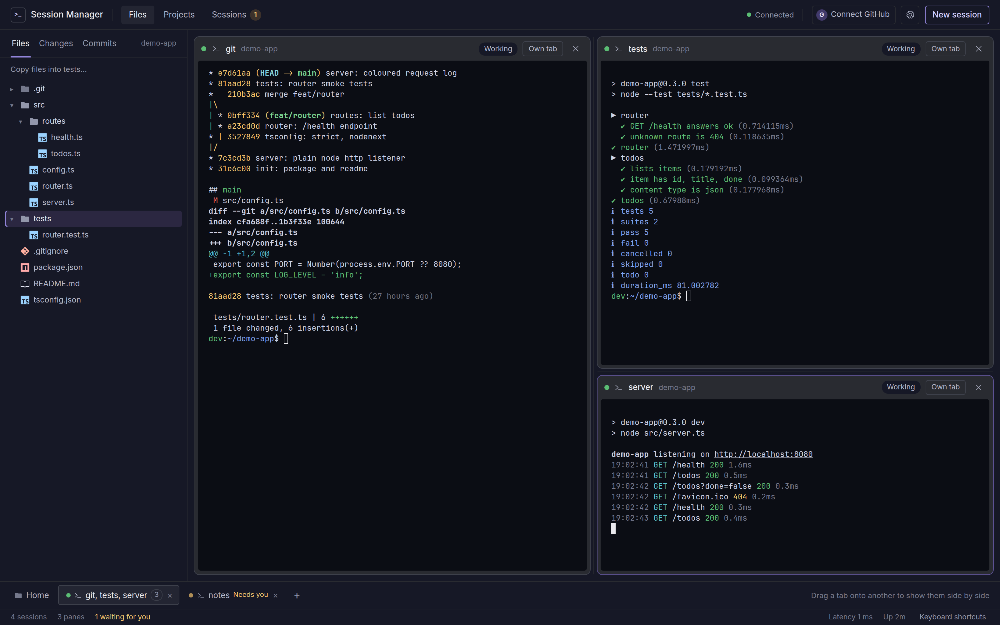
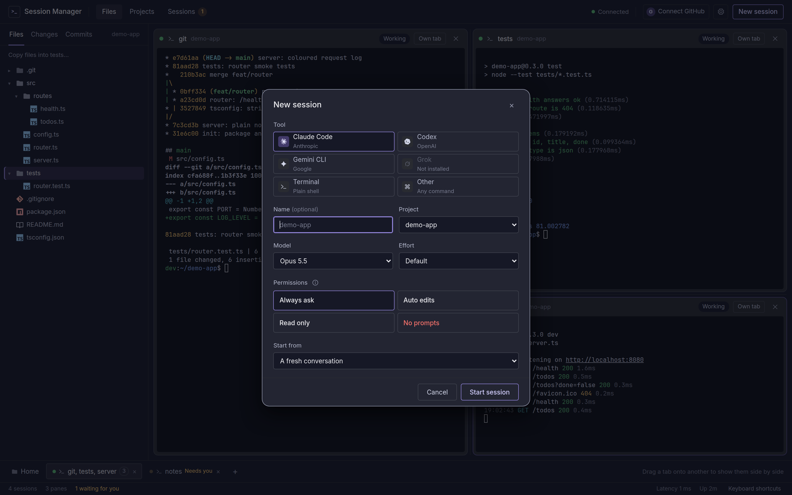
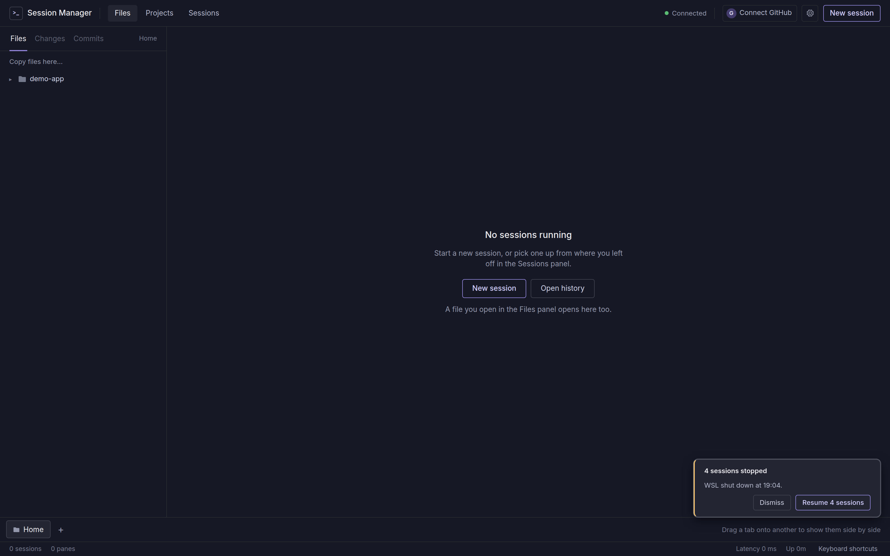

# AI CLI Session Manager

**Every AI coding agent you run, side by side, in one window — real terminals,
running inside WSL, that survive a restart.**

Claude Code, Codex, Gemini CLI, Grok and plain shells, each in a real
pseudo-terminal held by a backend inside WSL2. The window is only a view:
close a pane, switch tabs, reload — the session keeps running and its
scrollback comes back.

## Features

- 🖥️ **Sessions side by side.** Claude Code, Codex, Gemini CLI, Grok, Bash,
  Zsh, PowerShell, Command Prompt or any command you type. Up to four panes per
  tab; drag a tab onto another to split.
- 🚦 **Knows what each session is doing.** Working, Waiting for you, Needs your
  answer, Finished — for Claude Code read from its own transcript.
- 📊 **A status bar under every Claude session.** Model, mode, branch, cost,
  context, usage, lines changed — plus a table of the background agents it
  runs.
- 📁 **Files panel and editor panes.** Browse and edit the real file system,
  drop files in from Windows, see what changed since the last commit and
  browse the commits with their diffs.
- 🗂️ **Projects and GitHub.** A default model and permission mode per project;
  start one from a folder, a clone, or your own GitHub repositories.
- 🕘 **Session history with resume.** The sessions the app launched, across
  runs; a Claude session resumes its own conversation.
- 🔄 **Sessions survive updates.** A restart or an update keeps every open
  session running — same tabs, panes and scrollback.
- 🛟 **Recovers when WSL runs out of memory.** The app says what happened, one
  `Restart` brings it back, and your sessions resume in their old places.
- ⬆️ **Updates itself.** A notice when a new version is out, one `Update`
  button, the download checked against its SHA-256.
- 🔒 **Local only.** Bound to `127.0.0.1`; nothing about your sessions leaves
  the machine through this app.

## Install

1. **Download** `AI-Session-Manager-Setup-<version>.exe` from the
   [Releases page](https://github.com/YaroslavSavchenk/ai-cli-application/releases/latest).
2. **Run it.** It checks WSL2, asks which distribution and folder, and
   installs for your user only — no administrator rights, nothing third-party
   unless you tick it. The exe is not code-signed: at "Windows protected your
   PC", choose **More info → Run anyway**.
3. **Double-click "AI Session Manager"** on the Desktop. The first start after
   a Windows reboot takes 10–30 seconds while WSL boots.

Needs Windows 10 or 11 with WSL2 and a distribution with glibc 2.35 or newer
(Ubuntu 22.04+, Debian 12+); Claude Code inside it for Claude sessions — the
Setup offers to install it. Your projects, history and settings live in
`~/.ai-session-manager/` and survive every update and uninstall.

📖 The full guide — requirements, every wizard page, updating, uninstalling,
what is worth knowing: **[docs/install.md](docs/install.md)**.

## When WSL stops

WSL out of memory or shut down? The window shows "The app stopped
responding" with one `Restart`; the app comes back, tells you why it stopped,
and resumes every session in its old tab and pane.
[How it works](docs/restart-and-recovery.md#after-wsl-stops).

## Documentation

| | |
| --- | --- |
| 📦 [Install, update, uninstall](docs/install.md) | the Setup, step by step |
| 🛠️ [Development](docs/development.md) | run from a clone, develop inside WSL, tests, CI |
| 🔁 [Restart and recovery](docs/restart-and-recovery.md) | `Restart service`, a backend crash, after WSL stops |
| 🐙 [GitHub connection](docs/github.md) | paste a token, or set up Sign in with GitHub |
| 💾 [App data](docs/app-data.md) | every file in `~/.ai-session-manager/`, and the log |
| 🚢 [Release process](docs/release.md) | how a tag becomes a release |
| 🪟 [Launcher](launcher/README.md) | switches, configuration, troubleshooting |

Everything the app does, and how: [docs/features.md](docs/features.md). All of it: [docs/README.md](docs/README.md).

## Built with

Node.js 24 (TypeScript run directly) · [node-pty](https://github.com/microsoft/node-pty) ·
[ws](https://github.com/websockets/ws) · [xterm.js](https://xtermjs.org/) ·
vanilla TypeScript + [Vite](https://vite.dev/) · a native WebView2 window
(C#) · [Inno Setup](https://jrsoftware.org/isinfo.php)

## Contributing

Before changing code, read [CONTRIBUTING.md](CONTRIBUTING.md)
(how code is written) and [tests/README.md](tests/README.md) (how tests are
written) first; [docs/development.md](docs/development.md) gets a clone
running. Architecture and hard constraints: [.claude/PROJECT-SCOPE.md](.claude/PROJECT-SCOPE.md).

Found a security issue? Please report it privately — see [SECURITY.md](SECURITY.md).

## Repository layout

| Path | What lives there |
| --- | --- |
| `server/` | The WSL-side Node backend: sessions and PTYs, HTTP + WebSocket API, history, update and restart logic, `statusline.mjs`; `server/pty-host-main.ts` + `pty-host-server.ts` are the separate process that holds the PTYs across backend restarts, `pty-host-wire.ts` its wire, `pty-host-client.ts` + `pty-host-broker.ts` the backend's side (Nocturne D9) |
| `web/` | The browser frontend (vanilla TypeScript + Vite): `src/`, `index.html`, `mascot.html`, the design system notes in `DESIGN.md` |
| `shared/` | `protocol.ts`, the wire contract both sides import (it re-exports its topic modules `protocol-*.ts`) |
| `tests/` | The whole suite (`npm test`): `ui/` (frontend, `npm run test:ui`), `server/` (backend), `release/` (bundle, installer, launcher, workflows), `repo/` (the layout, author-path and file-size guards), `helpers/` (shared test modules, no tests), `fixtures/` (data files); how a test is written: `tests/README.md` |
| `docs/` | The documentation behind this page (index: `docs/README.md`) and its screenshots in `docs/images/` |
| `CONTRIBUTING.md` | How code is written here: module shapes, one home per helper, no dead code, file size (tests: `tests/README.md`) |
| `launcher/` | Windows-side start scripts, the shortcut maker, the native WebView2 host in `launcher/host/` |
| `installer/` | The Inno Setup script and its PowerShell helpers |
| `scripts/` | `build-bundle.sh` (the Linux bundle) and `release.sh` (tagging) |
| `.github/workflows/` | CI (`verify.yml`, `ci.yml`) and the release build |
| `design/` | Design sources: `session-manager/` (the current Nocturne handoff), and `peek-mascot/` (the first handoff was removed 2026-11-22, git history keeps it); `design/README.md` says what each holds |
| `memory/` | The project's memory, an Obsidian vault: `INDEX.md` (start here), `BACKLOG.md`, `decisions/`, `knowledge/`, and the work log in `log/<YYYY-MM>/<area>/` |
| `.claude/` | How the project is built with Claude Code: `PROJECT-SCOPE.md` (the current truth), `plans/` (master plans with their status table, part specs per plan, conventions in `plans/README.md`), `agents/`, `skills/` |

## License

[MIT](LICENSE) © 2026 Yaroslav Savchenko
